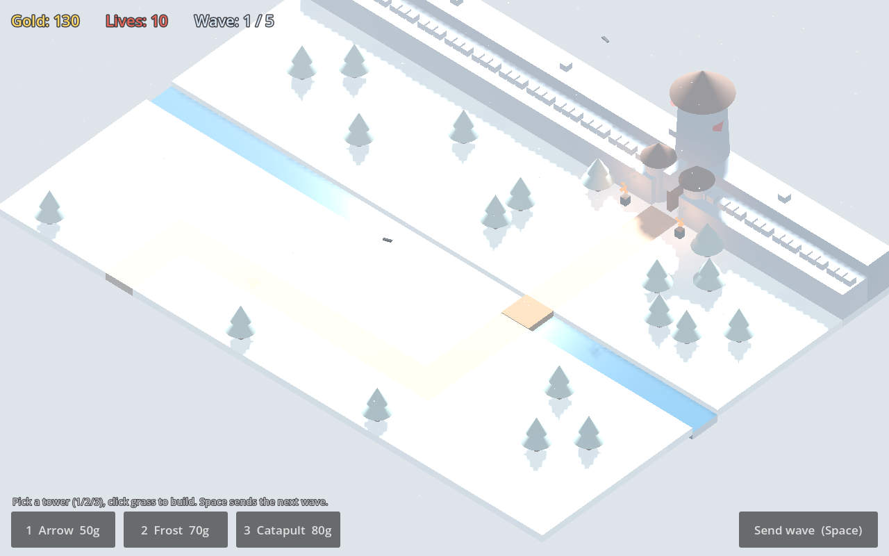

# Defend the Bridge

[](https://sw-fun.github.io/glm-godot/)

A small playable castle-defense demo: **Defend the Bridge**, the first
level of the [Evolving Game](https://github.com/sw-fun/evolving-game)
family, rebuilt in [Godot](https://godotengine.org) 4.7. Creeps march
up the road, over the river bridge, and to the castle gate. Build
towers on the grass beside the road and hold the gate through five
waves.

## Play

In a browser: the [live demo](https://sw-fun.github.io/glm-godot/)
(the picture above is a link to it).

Or run it natively with [Godot](https://godotengine.org/download) 4.7:

```bash
godot --path .          # run the project
godot -e --path .       # or open it in the editor
```

## How to play

| Input | Action |
| ----- | ------ |
| `1` / `2` / `3` | choose the Arrow (50g), Frost (70g) or Catapult (80g) tower |
| click on grass | build the chosen tower there |
| `Space` | send the next wave |
| `Esc` | put the tower picker down |

- **Arrow** fires quickly at one creep. **Frost** pulses and slows
  everything near it. **Catapult** lobs a stone slowly, but it lands
  hard on everything in a small area.
- Creeps come in three kinds: grunts, fast runners and heavy brutes.
- Each kill pays gold; each wave cleared pays a bonus; every creep
  that reaches the gate costs a life. You start with 130 gold and 10
  lives, and the waves grow heavier to the fifth.

## Build

The scene is built from Godot scenes: every piece (wall, gate, keep
tower, brazier, tree, crow, tower, creep, projectile) is a `.tscn`
under `scenes/`, the environment and layout live in `main.tscn`, and
the scripts under `scripts/` hold only what stays code: the shared
map data (`world.gd`), the game rules (waves, economy, projectiles in
`main.gd`) and the few behaviors that move (`enemy.gd`, `tower.gd`,
the pieces' placers). There are no art assets to load.

To export the web build (needs the Godot 4.7 export templates, and the
`Web` preset in `export_presets.cfg`, which ships with thread support
off so it runs from GitHub Pages as-is):

```bash
godot --headless --export-release "Web" build/index.html
```

Then serve `build/` from any static file server.

Pushes to `main` are built and published to GitHub Pages
automatically by `.github/workflows/pages.yml`.

## Copyright

Copyright (c) 2026 Michael A Wright

## License

MIT. See [`LICENSE`](LICENSE) and [`COPYRIGHT`](COPYRIGHT).
